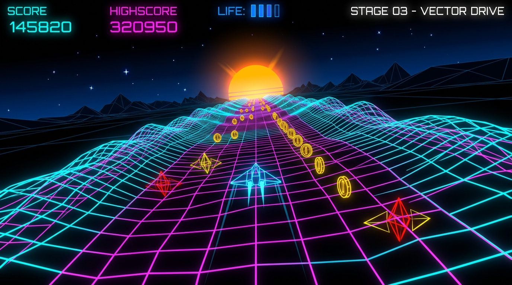

# Sine Drift 3D

A 3D retro arcade game that runs directly in your browser's address bar as a single Data URI under 3KB. No images, no libraries, no downloads—everything is rendered on the fly using HTML5 Canvas, Web Audio API, and trigonometric math.



Sine Drift 3D is built for the **Hack Club Bites** challenge with a strict 3,072-byte size budget. You fly a geometric spacecraft over a rolling 3D sine-wave grid, collect spinning golden coins, and weave through incoming obstacle drones while dynamic day/night lighting shifts overhead.

---

## How to use it

### Option 1: Run directly from your address bar (No install needed)
Open [dist/uri.txt](dist/uri.txt), copy the line, paste it straight into your browser's address bar (Chrome, Edge, Firefox, or Safari), and press **Enter**:

```text
data:text/html,<body style=margin:0;overflow:hidden;background:black><canvas id=c></canvas><script>M=Math;R1=M.random;x=c.getContext('2d');A=0;k={};hi=t=z=W=0;V=[0,1.4,-1];B=_=>(R1()-.5)*220;S=[0,1,2,3];stX=S.map(R1);RC=_=>C={x:B(),z:400+R1()*300};R=_=>{st=1;go=sc=cn=px=tk=0;sp=.02;E=S.map(i=>({x:i*60-90,z:180+i*90,vx:V[i%253],k:i%253}));RC()};R();st=0;P=(f,y,v=.25,d=.2)=>{A&&(o=A.createOscillator(),g=A.createGain(),y&&(o.type=y),o.frequency.value=f,g.gain.value=v,g.gain.linearRampToValueAtTime(0,m=A.currentTime+d),o.connect(g).connect(A.destination),o.start(),o.stop(m))};onkeydown=onpointerdown=e=>{A?A.resume():A=new AudioContext;k[e.keyCode]=1;st&&!go||R()};onkeyup=e=>k[e.keyCode]=0;onpointermove=e=>e.buttons&&(px+=e.movementX);P3=(X,r)=>[W/2+X*(m=280/r),Y0+(26*M.sin(r*.03+t)*M.cos(X/67)+35)*m];J=(X,r,b)=>x[b?'moveTo':'lineTo'](...P3(X,r));T=(a,b,c,d)=>[b,a,tc,c,tc,d].map((v,i)=>i&1?x.fillText(v,W/2,Y0+i*22-55):x.fillStyle=v);L=_=>{t+=.03;z+=sp*20;dy=.5-.5*M.cos(t*.2);u=1-dy;tc='rgb('+[g=u*255|0,g,g]+')';cl='rgb('+[0,g,g/2+70|0]+')';cp='rgb('+[q=130+g/3|0,g/2|0,q]+')';if(st&&!go){tk++&3||(sc++,sp+=1e-5);px=M.max(-160,M.min(160,px+(k[68]|k[39]?6:k[65]|k[37]?-6:0)));tk&15||P(99+(tk*9&63),'triangle',.05)}W==innerWidth||(W=c.width=innerWidth,H=c.height=innerHeight,Y0=H/2-30,x.textAlign='center',x.font='18px monospace');x.fillStyle='rgb('+[q=255-g,q,q*.8|0]+')';x.fillRect(0,0,W,H);x.fillStyle='rgba(255,255,255,'+u+')';for(s of stX)x.fillRect(s*W,(s*Y0+t*4)%25Y0,2,2);sY=Y0-60;x.shadowBlur=25;x.shadowColor=dy>.5?'orange':'gray';G=x.createRadialGradient(W/2,sY,0,W/2,sY,34);[0,1].map(j=>G.addColorStop(j,'rgb('+[j?70+150*dy|0:180+75*dy|0,j?60:160,(j?70:180)*u|0]+')'));x.fillStyle=G;x.beginPath();x.arc(W/2,sY,34,0,7);x.fill();x.shadowBlur=0;x.fillStyle=tc;x.fillText('SINE DRIFT',W/2,Y0-140);x.strokeStyle=cl;for(X=-160;X<161;X+=40){x.beginPath();for(Z=40,b=1;Z<1e3;Z+=30)(r=Z-z%2530)>20&&(J(X,r,b),b=0);x.stroke()}x.strokeStyle=cp;for(Z=60;Z<1e3;Z+=80)if((r=Z-z%2580)>20){x.beginPath();for(X=-160;X<161;X+=40)J(X,r,X==-160);x.stroke()}if(st){!go&&((C.z-=sp*22)<20||M.abs(C.z-65)<15&&M.abs(C.x-px)<25&&(cn++,sc+=50,P(1568),1))&&RC();C.z>20&&([p,q]=P3(C.x,C.z),x.fillStyle='gold',x.beginPath(),x.ellipse(p,q,M.sin(t*4)**2*(cr=3e3/C.z),cr,0,0,7),x.fill());E.map(e=>{!go&&(e.z-=sp*22,e.x+=e.vx,M.abs(e.x)>110&&(e.vx*=-1),e.z<20&&(e.z=550,e.x=B(),e.vx=V[e.k]),M.abs(e.z-68)<7&&M.abs(e.x-px)<24&&(go=1,sc>hi&&(hi=sc),P(99,'sawtooth')));e.z>20&&([p,q]=P3(e.x,e.z),d=3e3/e.z,x.fillStyle='rgb('+[255,e.k*60,e.k*120].map(v=>v*(.3+.7*dy)|0)+')',x.beginPath(),[-d,d].map(w=>(x.lineTo(p+w,q),x.lineTo(p,q+w))),x.fill())})}[sx,sy]=P3(px,65);x.fillStyle='gold';x.fillRect(sx-2,sy+4,4,4);x.strokeStyle='white';for(i of[-14,14])x.beginPath(),x.moveTo(sx,sy-15),x.lineTo(sx+i,sy+10),x.lineTo(sx,sy+3),x.fillStyle=go?'red':i<0?cl:'blue',x.fill(),x.stroke();!st&&x.strokeRect(W/2-85,Y0-8,170,74);K=`SC:${sc} CN:${cn} HI:${hi}`;!st||go?T(...go?['CRASH','red',K,'RETRY']:['','','DODGE DRONES','PLAY']):x.fillText(K,W/2,24);requestAnimationFrame(L)};L();</script></body>
```

### Option 2: Run developer source
Open [src/index.html](src/index.html) in your browser.

### Controls
- **Steer Left / Right**: Press **A / D**, use the **Arrow Keys**, or **click and drag** your mouse across the screen.
- **Collect Coins**: Fly directly into spinning gold coins (+50 points each).
- **Avoid Drones**: Dodge roaming hunter drones that bounce laterally across lanes.
- **Start / Restart**: Press any key or click anywhere on the screen.
- **Sound**: Procedural audio synthesizer begins automatically on your first interaction.

---

## How it works

1. **3D Perspective Camera Projection**: World coordinates $(X, Z)$ are projected to 2D screen coordinates using perspective scaling $(280 / Z)$.
2. **Sine-Wave Terrain**: The rolling wireframe surface is generated procedurally on each animation frame using trigonometric ripples:
   `Y = 26 * sin(Z * 0.03 + time) * cos(X / 67) + 35`
3. **Procedural Web Audio**: Sound effects are generated in real-time with Web Audio oscillator nodes (triangle wave engine hum, 1568Hz sine chime on coin pickup, and 99Hz sawtooth crunch on crash).
4. **Dynamic Lighting Cycle**: A cosine time harmonic smoothly transitions colors from bright daylight into a dark starry midnight neon landscape.

---

## Building

To verify that the code meets the Hack Club Bites size budget ($\le 3,072$ bytes) and passes JavaScript syntax validation:

```bash
npm install
node build.mjs
```

Running `node build.mjs` verifies the budget and writes the address-bar string to `dist/uri.txt`.

### Size Budget Report
- **Budget Limit**: 3,072 bytes
- **Raw HTML**: 3,044 bytes (28 bytes remaining)
- **Data URI**: 3,069 bytes (3 bytes remaining)
- **Syntax**: Valid

---

## Project Structure

```text
├── src/
│   └── index.html           # Full, readable developer source code (unminified)
├── dist/
│   ├── one-line-game.html   # Production single-line HTML
│   └── uri.txt              # Address-bar ready Data URI (<3KB)
├── preview.jpg              # Gameplay visual
├── build.mjs                # Size verification and uri.txt generator
├── package.json             # NPM metadata and scripts
└── README.md                # Documentation
```
